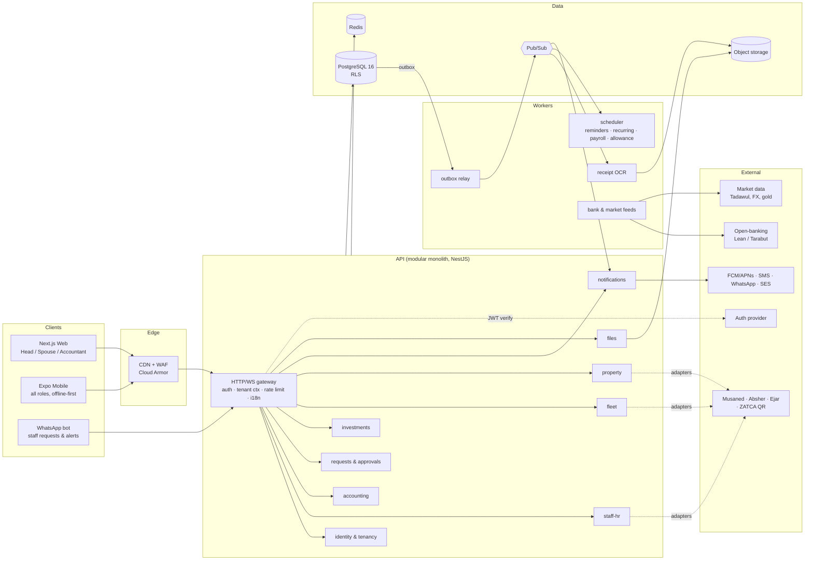
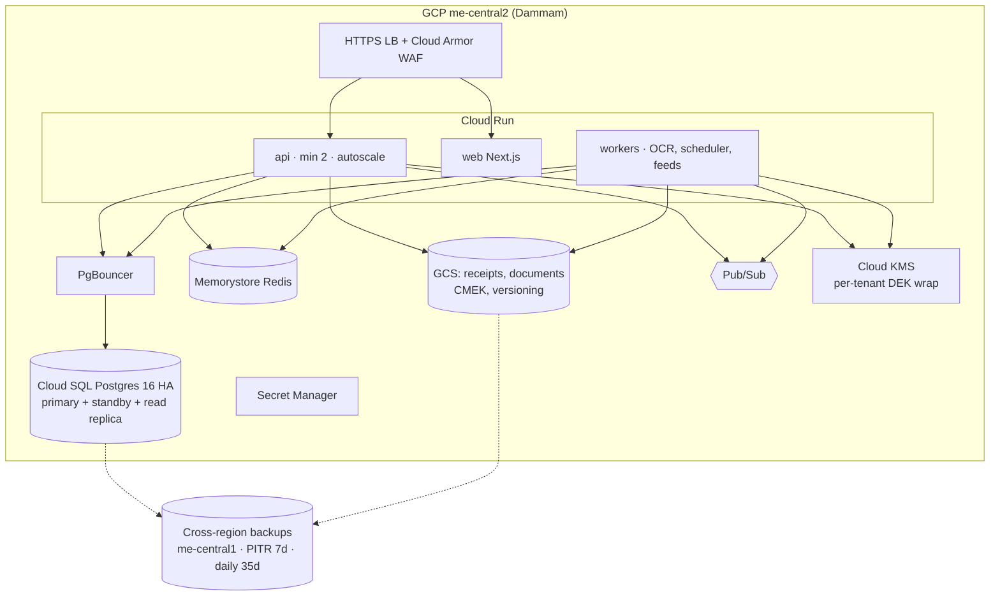

# Household ERP: High-Level Architecture

> Version 1.1 · 2026-11-04 · Status: proposed baseline
>
> **v1.1:** RLS write coverage is now complete and a self-promotion bug is fixed. Adds the EFA Office Admin role, the HR governance, petty cash, work order and family travel modules, KMS envelope encryption, the ZATCA QR and OCR receipt pipeline, and next-intl routing.

## 1. What we are building

This is a multi-tenant SaaS product. Each **household is a tenant**. A household runs its domestic operations (staff HR, household money, investments, vehicles and properties) in one place. Each member sees only what their role allows.

| Driver | Consequence for the architecture |
|---|---|
| Arabic first, 6 languages (ar, en, hi, tl, am, bn) | The UI is RTL by default and uses logical CSS properties. User-entered text is stored as JSONB keyed by locale. Notifications are rendered in the *recipient's* language. |
| Very different users in one tenant (owner, spouse, children, maids, drivers) | The security principal is the **Membership** (user × household), not the user. Postgres RLS enforces scopes (`ALL / OWN / ASSIGNED / WARDS`). |
| Staff often use cheap Android phones, have low literacy, and share devices | Phone OTP login. The mobile app is icon-led, voice-friendly and works offline. Each staff role gets its own simple home screen. |
| Highly sensitive data (passports, salaries, net worth) | Field-level encryption for ID numbers. Sensitive files use short-lived signed URLs. The audit log is append-only. No card PANs are stored. |
| GCC regulation (KSA PDPL, Musaned, Ejar, ZATCA e-invoice QR) | Data residency in-region. The connectors to these platforms are pluggable "integration adapters". |
| Small team at the start, possibly a large B2C scale later | Start as a **modular monolith** with strict module boundaries plus async workers. Modules can be extracted into services later without changing the API. |

## 2. Technology decisions

| Layer | Choice | Why |
|---|---|---|
| Monorepo | **Turborepo + pnpm** | One TypeScript codebase. Shared Zod schemas, API client, i18n catalogues and design tokens. |
| Web | **Next.js 15 (App Router, RSC)** with **`next-intl` 4** (`apps/web`). Logical CSS properties only | Every route has a locale prefix: `/ar`, `/en`, `/hi`, `/tl`, `/am`, `/bn`. `<html lang dir>` is set from the segment. Message keys are type-checked (`AppConfig.Messages`). See §7. |
| Mobile | **React Native (Expo SDK, EAS)**, **`use-intl`** (the framework-agnostic core of next-intl), `I18nManager.forceRTL`, WatermelonDB for offline | Uses the same `useTranslations()` API and the same ICU catalogues (`@herp/i18n`) as the web app. `next-intl` itself is Next.js-only, because it depends on Next's routing and middleware. Flutter would fork the type system and the i18n pipeline. |
| API | **NestJS (Node 22, TypeScript)**: REST `/v1` with an OpenAPI 3.1 contract, plus WebSocket gateway | Its module system matches the bounded contexts. Guards and interceptors fit the RBAC and tenant context well. |
| ORM | **Prisma 6** (`prisma/schema.prisma`) | Typed client. Each request runs inside a transaction that sets the RLS context (see §5). |
| Database | **PostgreSQL 16** with RLS, `pgcrypto`, `pg_trgm`, `citext` | One shared schema with row isolation. This is the simplest model that still has a hard database-level guarantee. |
| Auth | **Supabase Auth (GoTrue)** or GCP Identity Platform: phone OTP, email/password, Apple/Google, passkeys | Issues a JWT whose `sub` maps to `users.id`. A custom `household_id` claim is added via an access-token hook. |
| Files | Object storage (Supabase Storage / GCS / S3) with signed URLs, AV scan on upload | Holds receipts, passports, contracts and vehicle photos. |
| Async | **Postgres outbox → Pub/Sub (or SQS)**, plus BullMQ/Redis for scheduled jobs | Events are reliable because they are written in the same transaction as the business change. |
| Receipts | **`@herp/zatca`** (TLV decoder for ZATCA QR codes, Phase 1 and 2) and **`@herp/receipt-parser`** (Arabic/English OCR text parser, QR merge, pure-JS QR detection) | A ZATCA QR is authoritative for seller, VAT number, time, total and VAT. OCR fills the gaps and is cross-checked against it. See §8.1. |
| Field encryption | **`@herp/crypto`**: AES-256-GCM per-tenant DEK, wrapped by Cloud KMS (`GcpKmsProvider`, CRC32C-verified), plus an HMAC blind index | Iqama, passport, national-ID and border numbers, IBANs, and lease counterparty IDs. See §5.1. |
| OCR / AI | Document AI or Textract for receipts (behind the `OcrProvider` port). An LLM (Claude) for line-item categorisation, translation of requests, and the Arabic ↔ staff-language chat bridge | Runs behind an `AiGateway` port so the vendor can be swapped. No PII is sent unless the tenant opts in. |
| Notifications | FCM/APNs push, WhatsApp Business API, SMS (Unifonic/Twilio), email (SES) | Channel preference is set per user. Templates exist per locale. |
| Infra as code | Terraform plus GitHub Actions | |
| Observability | OpenTelemetry → Grafana (Tempo/Loki/Prometheus) and Sentry | Every log line carries `householdId` and `requestId`. PII is redacted. |

### Hosting recommendation

* **Production (KSA customers): GCP `me-central2` (Dammam).** This keeps data in the Kingdom for PDPL. It runs Cloud Run (API and workers), Cloud SQL Postgres HA, GCS, Pub/Sub, Memorystore and Cloud Armor. A UAE/GCC-wide tenant cell can run in `me-central1` (Doha).
* **MVP / pilot: managed Supabase** (Auth, Postgres, Storage, Realtime), with the NestJS API on Cloud Run. The schema and `rls.sql` are written to be Supabase-compatible. The JWT-claim fallback in `app.current_user_id()` lets supabase-js clients query safely under the same policies. Moving from Supabase to Cloud SQL is a `pg_dump` plus an auth-provider swap.

## 3. System context



### Module boundaries

Each NestJS module owns its tables and talks to other modules only through:

1. **Its public service interface** (an in-process call, synchronous), or
2. **Domain events** written to `outbox` in the same DB transaction (asynchronous). Examples: `request.approved`, `receipt.extracted`, `payroll.paid`, `document.expiring`.

`requests` is the **cross-module workflow engine**. A salary advance, a leave, a purchase, a vehicle use or a maintenance job is each a `Request` with a typed `payload`. When it is approved, the owning module reacts. For example, `staff-hr` creates `SalaryAdvance` and `accounting` posts a `Transaction`. This keeps one approval UX and one audit trail.

Extracting a service later means: move the module into its own deployment, replace in-process calls with gRPC/HTTP, and keep the events unchanged. `accounting` and `investments` are the likely first candidates because of feed load.

## 4. Request lifecycle and tenant context

```mermaid
sequenceDiagram
  participant C as Client
  participant G as API Gateway (Nest guard)
  participant S as Module service
  participant DB as Postgres (RLS)
  C->>G: GET /v1/transactions  Authorization: Bearer JWT<br/>X-Household-Id: h1 · Accept-Language: ar
  G->>G: verify JWT → userId<br/>resolve Membership(userId, h1) from cache<br/>check permission finance.transactions.read
  G->>S: ctx {userId, householdId, membershipId, perms, locale}
  S->>DB: BEGIN; SET LOCAL ROLE app_user;<br/>set_config('app.user_id'), set_config('app.household_id')
  S->>DB: SELECT … FROM transactions (no tenant WHERE needed)
  DB-->>S: rows already filtered by tenant + scope
  S-->>C: 200, localized JSON (i18n fields resolved to "ar" with fallback)
```

* **Defence in depth.** The guard checks the permission and returns 403 early. RLS guarantees isolation even if a query is buggy. Tests (`tests/rls_test.sql`) assert both layers.
* Prisma integration uses a `$extends` client wrapper that opens an interactive transaction per request and issues the two `set_config` calls. A connection pooler (PgBouncer, transaction mode) is compatible because the settings are `LOCAL`.
* **Background workers** connect as `app_service` (`BYPASSRLS`). They must pass `householdId` explicitly. A lint rule bans un-scoped queries in worker code.

## 5. Multi-tenancy and data security

| Concern | Design |
|---|---|
| Isolation model | Shared DB, shared schema, `householdId` on every tenant table, plus `FORCE ROW LEVEL SECURITY`. Enterprise or family-office tenants can be placed in a **dedicated cell** (own DB) via the tenant router without code changes. |
| Active-tenant spoofing | `app.current_household_id()` returns the household **only if the caller holds an ACTIVE, unexpired membership**. Otherwise it returns NULL, so every row is hidden. This is tested: "head1 spoofing H2 context → 0 rows". |
| Role scopes | `RolePermission.scope` ∈ `ALL` (everything in the household), `OWN` (rows the member created or is the subject of), `ASSIGNED` (rows assigned to them: vehicles, tasks), `WARDS` (rows of their dependents). Per-member overrides allow grant or deny, and deny wins. |
| Sensitive fields | ID numbers, IBANs and lease counterparty IDs are encrypted in the app layer. See §5.1. Only last-4 values are stored in clear. Card data is tokenised at the issuer, so we stay outside PCI-DSS scope. |
| Write coverage | Every INSERT, UPDATE and DELETE on all 61 RLS tables is covered by a restrictive policy or a revoked privilege. `tests/rls_test.sql` checks the system catalogue, so a new table without write policies **fails CI**. |
| Protected tables | `budgets`, `allowance_plans`, `identity_documents`, `roles`, `vehicle_assignments` and `receipts` can be UPDATEd or DELETEd **only** by `HOUSEHOLD_HEAD` or `EFA_OFFICE_ADMIN`. The check is role-based (`app.is_household_admin()`), so no permission override can grant it. |
| Escalation guards | The `memberships_guard` trigger enforces four rules. Members may edit only their own display name. Only admins can grant or change an admin role. Only admins can create Head-type roles or change permission matrices and overrides. A household always keeps one active Head. *(v1.0 let any member change their own `roleId`. This is now fixed and covered by a regression test.)* |
| Approval integrity | Clients cannot insert approval rows. A trigger routes each new request through the matching `ApprovalPolicy` (amount band → steps, auto-approve threshold). If no policy matches, it goes to the household admins. A requester is never their own approver. |
| Immutable evidence | Financial ledger rows, petty-cash logs and policy acknowledgments cannot be deleted. Published governance documents are frozen; changes are new versions. Column-level grants limit what can be updated (for example, a signer can only set `withdrawnAt`). |
| Files | Private buckets with the path `/{householdId}/{entity}/{uuid}`. Signed URLs last 5 minutes, or 60 s for `isSensitive`. Each sensitive file view writes an `AuditLog(VIEW_SENSITIVE)`. |
| Audit | `audit_logs` is append-only (UPDATE/DELETE revoked) and records before/after JSON diffs. It is exported nightly to WORM storage. |
| Ledger integrity | Transactions cannot be deleted under any role. Corrections are reversal rows. Balances are derived from postings and reconciled nightly. |
| Minors | Dependents are linked to a guardian. Guardians get `WARDS` scope over their children's spend. Minors cannot change their own allowance (checked by policy). |
| Staff dignity and privacy | Attendance geolocation is opt-in and limited to check-in. There is no continuous tracking. Passport custody (`heldByEmployer`) is recorded, which helps households stay compliant with labour rules. Staff always see their own contract and payslips in their own language. |
| Residency and PDPL | In-region hosting, a per-tenant data-export endpoint, right-to-erasure (crypto-shredding of the tenant DEK), and consent records for AI features. |

### 5.1 Field-level encryption (`packages/crypto`)

```
Cloud KMS KEK (never leaves KMS, me-central2)
   └─ wraps ─▶ per-household DEK + blind-index key   (tenant_keys: wrapped bytes only)
                  └─ AES-256-GCM ─▶ "v1.<keyVer>.<iv>.<ct‖tag>"   in numberCiphertext / ibanCiphertext / …
                  └─ HMAC-SHA256 ─▶ numberBlindIndex / ibanBlindIndex   (exact-match search, dedupe)
```

* **AAD binding.** Each ciphertext is bound to `householdId | table.column | keyVersion`. A value copied to another household, or moved from the IBAN column to the passport column, fails to decrypt. Each wrapped DEK is bound to its own household in the same way.
* **Blind index.** Searching "who has iqama 2…" uses an HMAC over the normalised value (`numberBlindIndex`) and never decrypts. The index key is per tenant, so the same passport in two households produces different indexes.
* **Key cache.** `TenantKeyring` caches unwrapped keys for 5 minutes, so a list of 50 passports costs one KMS call. Evicted keys are zeroed.
* **Rotation.** Add a key version, mark the old one `DECRYPT_ONLY`, and let a worker re-encrypt (`FieldCipher.rotate`) and recompute indexes.
* **Crypto-shredding.** Mark the key `DESTROYED` and destroy the KMS key version. The tenant's encrypted fields are then unrecoverable (PDPL erasure).
* `LocalKmsProvider` (for dev and tests) refuses to start when `NODE_ENV=production`.
* **Migration 0002** drops the old plaintext columns. That is safe because no environment holds data yet. Any environment that does must run an encrypt-and-backfill job between "add columns" and "drop columns".

## 6. RBAC model

```
User ──< Membership >── Household
            │  ├─ roleId ──> Role (per household, seeded from SystemRole template)
            │  │               └─< RolePermission(permissionId, scope)
            │  ├─< MembershipPermission(permissionId, granted, scope)   # overrides
            │  └─ guardianId ──> Membership                            # WARDS
```

Default matrix (`prisma/seed.sql`, customisable per household). ★ marks the six protected tables, whose UPDATE and DELETE are Head and EFA only, whatever the matrix says.

| Permission area | Head | EFA Office Admin | Spouse | Dependent | Staff | Driver | Accountant | Guest |
|---|---|---|---|---|---|---|---|---|
| Household settings / billing | ALL | – | – | – | – | – | – | – |
| Members & roles (★ roles) | ALL | ALL | ALL (no admin roles) | – | – | – | – | – |
| Staff profiles / documents (★ docs) | ALL | ALL | ALL | – | OWN | OWN | – | – |
| Payroll & advances | ALL | ALL | ALL | – | OWN | OWN | read ALL | – |
| Bank accounts | ALL | ALL | ALL | – | OWN (petty cash) | OWN | read ALL | – |
| Cards | ALL | ALL | ALL | OWN | – | OWN | read ALL | – |
| Transactions, ★ receipts, ★ budgets, ★ allowance | ALL | ALL | ALL | OWN | OWN | OWN | read ALL | – |
| Requests | create/approve | create/approve | create/approve | create OWN | create OWN | create OWN | read | – |
| Investments | ALL | ALL | read | – | – | – | read | – |
| Fleet (★ vehicle assignments) | ALL | ALL | ALL | – | – | ASSIGNED | – | – |
| Property | ALL | ALL | ALL | report issue | report issue | report issue | read | report issue |
| Governance: publish / read ledger | ALL | ALL | ALL | – | read & sign | read & sign | – | – |
| Petty cash | ALL | ALL | ALL | – | own float: log | own float: log | read ALL | – |
| Work orders | ALL | ALL | ALL | raise OWN | raise; see ASSIGNED | raise; see ASSIGNED | – | – |
| Travel | ALL | ALL | ALL | trips they are on | trips they are on | trips they are on | – | – |

`EFA_OFFICE_ADMIN` is the **EFA office: Esam Alnahdi Family Affairs (مكتب عصام النهدي الخاص)**, which runs the household's operations on the Head's behalf. Official label: **مكتب EFA - الإدارة التشغيلية**. The role holds every permission except billing and deleting the household, and shares the Head's exclusive UPDATE/DELETE rights on the six protected tables. Receipt confirmation is written by the background worker, because receipt UPDATE is admin-only (approved design).

## 7. Internationalisation and RTL

**Three kinds of text are kept strictly separate.**

1. **UI strings.** ICU MessageFormat catalogues live in `packages/i18n/{ar,en,hi,tl,am,bn}.json`. They are managed in Tolgee/Crowdin and type-checked keys are generated at build time. Arabic plural rules (zero/one/two/few/many/other) come free with ICU.
2. **User content.** Any field ending in `*I18n` is JSONB, for example `{"ar":"تصليح المكيف","en":"Fix the AC"}`. When an Arabic speaker creates a task for a Filipina housemaid, the API stores the original under `ar` and enqueues machine translation into the assignee's `preferredLocale` (`tl`). The UI shows a "translated" chip with a toggle back to the original. Read resolution order: requested locale → user's locale → `originalLocale` → `ar` → first key.
3. **Notifications.** Only `templateKey` and `params` are stored. The text is rendered at send time in the recipient's language. Amounts and dates are formatted with `Intl` for that locale.

**Routing (`apps/web`).** `next-intl` serves the six locale-prefixed route trees, statically pre-rendered. A path without a prefix (`/`, `/staff`) is negotiated in our middleware in this order: `NEXT_LOCALE` cookie, then Accept-Language (q-ordered), then Arabic. We don't use next-intl's built-in detection: it canonicalises tags through ICU, which turns `tl` into `fil`, so Tagalog and `fil-PH` visitors were silently served Arabic. `negotiateLocale()` maps `fil` to `tl`. The catalogues load through `loadMessages(locale)`, one lazy chunk per language, and the same function serves Metro on mobile.

**RTL implementation.**

* Web: `<html lang dir>` comes from the locale. Tailwind uses only logical utilities (`ms/me/ps/pe/start/end`), enforced by an ESLint rule that bans `ml-`, `mr-`, `left-` and `right-`. Directional icons flip with `rtl:-scale-x-100`. Charts use mirrored axes.
* Mobile: `I18nManager.allowRTL/forceRTL` on a locale switch triggers a reload. `Yoga` start/end props are used and swipe gestures are mirrored.
* Fonts: IBM Plex Sans Arabic, Noto Sans Devanagari, Noto Sans Ethiopic and Noto Sans Bengali are subset per locale.
* Numbers and dates: Arabic UI defaults to Latin digits (a user setting switches to Arabic-Indic digits). There is an optional Hijri calendar display (`Intl.DateTimeFormat('ar-SA-u-ca-islamic-umalqura')`). Storage is always UTC/Gregorian. Hijri-dated leases are flagged and their Hijri due dates are kept verbatim.
* Bidi safety: user names and plate numbers are wrapped in `<bdi>` so mixed Arabic and Latin text renders correctly.

## 8. Key flows

### 8.1 Receipt → expense (OCR)
1. The driver snaps a receipt in the app (it works offline and is queued). `POST /v1/receipts` returns a pre-signed upload URL. The client uploads directly to storage.
2. `receipt.uploaded` goes to the outbox, then the OCR worker. The worker dedupes on `sha256` and calls `processReceiptImage()`, which runs OCR (`OcrProvider`) and local QR detection (`JsQrDetector`) in parallel.
   * **ZATCA QR found:** the TLV is decoded. Phase 1 has tags 1–5; Phase 2 adds 6–9. The decoder checks the 15-digit 3…3 VAT number and that VAT equals 15/115 of the total, to the halala in BigInt. A timestamp without an offset is read as KSA time. The QR values win. If the printed total differs from the QR total, the receipt is flagged for review.
   * **OCR only:** Arabic-Indic digits and separators are normalised, and Arabic letter forms are unified for keyword matching. Totals are ranked: "grand total / الإجمالي شامل الضريبة" beats "total / المجموع", and subtotal, "VAT no.", cash and change lines are excluded. VAT rates such as "15%" are never read as amounts. Hijri dates are converted with ICU's Umm al-Qura calendar. Confidence comes from the arithmetic (VAT = 15/115 × total, or subtotal + VAT = total). An overall confidence below 0.8 sends the receipt to review.
3. An LLM maps merchant and line items to the household's `Category` tree, with confidence. The result is a `Transaction(status=PENDING, source=RECEIPT_OCR)` linked to the receipt, with the driver's card or petty-cash account as the source.
4. If the amount is above the policy threshold, or confidence is below 0.8, the approver gets a review card. Otherwise the transaction auto-posts. Budget alerts fire on post.

### 8.2 Request & approval (for example, a maid asks for a salary advance)
1. `POST /v1/requests {type: SALARY_ADVANCE, amount: 800}` in Tagalog. The title is auto-translated to Arabic for approvers.
2. The engine picks the matching `ApprovalPolicy` (type + amount band) and creates `Approval` rows per step. Approvers get a push or WhatsApp message with approve/reject deep links.
3. On final approval, the `request.approved` event triggers two things. `staff-hr` creates a `SalaryAdvance` with an instalment plan. `accounting` posts the cash-out transaction. The next `PayrollRun` adds an `ADVANCE_RECOVERY` line automatically.

### 8.3 Expiry & due-date engine
A nightly scheduler scans `identity_documents.expiryDate`, `vehicles.(registration|insurance|inspection)Expiry`, `leases.endDate`, `rent_payments.dueDate`, `utility_bills.dueDate` and `maintenance_records.nextDueDate`. It upserts `Reminder` rows at T-60/30/7/1 days. A dispatcher sends due reminders through the recipient's channels. "Iqama expires in 30 days" is the highest-value notification in the product.

### 8.4 Monthly payroll
On the 25th, `PayrollRun(DRAFT)` is generated from active contracts, plus allowances, approved overtime, unpaid leave deductions and advance recoveries. The head reviews and approves it. Paying it marks it `PAID`, posts one `Transaction` per line and sends each staff member a payslip in their language. The end-of-service accrual is computed by a pluggable strategy (`SA_DOMESTIC`, `AE_DOMESTIC`, …).

### 8.5 HR governance: policies, code of ethics, privacy agreements
* **Policies** are job-specific standing or daily instructions (a driver's pre-trip safety check, a nanny's child-safety rules), targeted by `staffTypes`. **Codes of ethics** and **privacy agreements** apply to the whole household. Privacy agreements cover NDA, CCTV/GPS surveillance, data processing and child privacy. Each records the lawful basis, purposes, data categories, retention, and the **excluded private zones** (staff quarters, bathrooms).
* **Publishing** freezes the text, and a trigger stamps `publishedAt` and the SHA-256 `contentHash`. Any change is a new version. Staff can read only PUBLISHED documents.
* **One evidence ledger.** `policy_acknowledgments` records who signed which version, in which language (`locale`), the hash of the exact text shown, and the method. Methods are tap, typed name, drawn signature, OTP, or verbal with an independent witness for staff with low literacy. A trigger stamps the server time, so a client cannot backdate. Daily policies are signed once per day. Rows are never deleted.
* **Consent withdrawal (PDPL).** A signer can set `withdrawnAt` on a withdrawable agreement. That is the only column they can update. A re-consent is a new row (partial unique index: one active consent per agreement).

### 8.6 Petty cash (imprest floats)
Each driver or housekeeper float is a `PettyCashAccount` with a `floatLimit`. A trigger maintains the balance under a row lock. A top-up adds money, an expense or return subtracts it, and only an adjustment may be negative. The trigger refuses overdrafts, top-ups beyond the limit, and expenses over `receiptRequiredOver` with no receipt. A custodian's own expenses land as `PENDING_REVIEW`. Custodians can never top themselves up, approve their own expenses, set the balance, or delete logs (column grants plus policies). The authorization check runs in a separate invoker trigger *before* the balance logic, so error messages never reveal another person's balance.

### 8.7 Work orders and multilingual instructions
Work orders are numbered per household (WO-0001…). They can be assigned to a person or a pool (`assigneeStaffType`) and link to a property, unit, vehicle, maintenance ticket, request or trip. Each instruction is stored in its original language and machine-translated into the assignee's locale (`translationStatus`). An instruction flagged **`isSafetyCritical`** (allergies, medication, child safety) blocks dispatch until its translation is `HUMAN_REVIEWED`. Assignees can move an order to COMPLETED; only the requester or a manager can mark it VERIFIED and rate it.

### 8.8 Family travel
A `Trip` has passengers (members, staff such as a travelling nanny, or named guests) and bookings (flights, hotels, cars, visas, insurance), each optionally linked to a ledger transaction. Staff passengers link to their passport `IdentityDocument`, so the expiry engine can warn about passport validity and exit/re-entry visas before departure. Passengers see the trips they are on and those trips' bookings, and nothing else.

### 8.9 Net worth & zakat
Market feeds write `AssetValuation` rows (Tadawul end-of-day, FX, gold price per gram). Net worth combines holdings at the latest valuation, real estate at the latest appraisal, and cash account balances, minus loans. The zakat report sums the zakatable assets held a full lunar year (hawl) above nisab, using the gold or silver standard per household setting, at 2.5%. It is shown as a guide, with a disclaimer, and is exportable.

## 9. Deployment topology



* **Environments:** `dev` (per-PR preview on Vercel or Cloud Run plus a Neon/Supabase branch DB), `staging` (prod-like, anonymised data), `prod`.
* **CI/CD:** lint, type-check, unit tests, `prisma validate`, migration dry-run, **RLS test suite against an ephemeral Postgres**, then build → deploy to staging → smoke tests → manual promotion. Migrations use expand/contract and never block.
* **SLOs:** API p95 < 300 ms; 99.9% monthly availability; RPO 5 min (PITR); RTO 1 h.
* **Scale:** around 50 rows per household per day. 100k households is about 1.8 B rows a year on the largest tables. `transactions`, `asset_valuations` and `audit_logs` get monthly native partitions (by `occurredAt` / `asOf` / `createdAt`) once they pass about 50 M rows. Analytics are offloaded to BigQuery via Datastream (CDC).

## 10. Roadmap

| Phase | Scope |
|---|---|
| **MVP (≈ 12 weeks)** | Auth and households, RBAC, staff profiles, documents and expiry reminders, manual transactions, receipts with OCR, requests and approvals, vehicles and maintenance, ar/en |
| **v1.1** | Payroll and advances, cards and allowance, budgets, property, leases and utility split, all 6 locales, WhatsApp bot for staff |
| **v1.2** | Investments and net worth, zakat, open-banking feeds, Musaned/Ejar/Absher adapters |
| **v2** | Family-office tier (multiple households under one office, consolidated reporting), dedicated tenant cells, AI assistant ("كم صرفنا على البنزين هذا الشهر؟", "How much did we spend on fuel this month?") |

## 11. Repository layout

```
household-erp/
├─ apps/
│  ├─ web/                 Next.js 15 + next-intl 4: src/app/[locale]/…, src/i18n/{routing,request,navigation}.ts, src/middleware.ts
│  ├─ mobile/              Expo: source only for now (use-intl IntlRoot); joins the workspace with the Expo toolchain
│  ├─ api/                 (next) NestJS modules
│  └─ workers/             (next) OCR, scheduler, feeds, outbox relay, key rotation
├─ packages/
│  ├─ i18n/                locales, direction, negotiation, resolveI18n, loadMessages, ICU catalogues ×6
│  ├─ zatca/               ZATCA QR TLV decode/encode and validation
│  ├─ receipt-parser/      OCR text parser, QR merge, OcrProvider port, JsQrDetector, processReceiptImage
│  └─ crypto/              KMS envelope encryption, blind index, Saudi ID/IBAN validators, seal/unseal
├─ prisma/                 schema.prisma, migrations/0001 + 0002, seed.sql, rls.sql
└─ tests/                  rls_test.sql (database security suite), apply.sh
```
